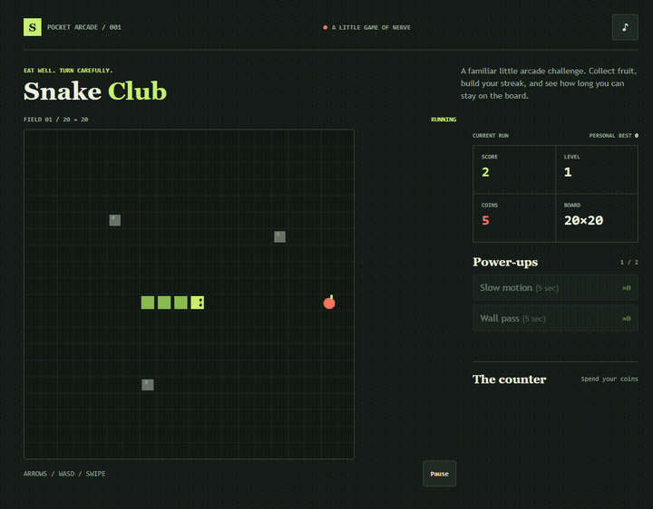

# Snake Club

A tiny, dependency-free Snake game that runs in the browser.

## Play

Open `index.html` in a modern browser, or serve this folder with any static file server. No build step or install is required.

## Controls

- Arrow keys or `W` `A` `S` `D`: steer
- `Space`: pause or resume
- `1`: use slow motion
- `2`: use wall pass
- On touch screens: tap the direction pad or swipe across the board

## Game

Eat fruit to grow and earn one coin per fruit. Every five fruit raises the level, adds obstacles, and increases the speed. Hitting a wall, rock, or your body ends the run. Coins, best score, mute preference, owned skins, and power-ups are saved in this browser.

Spend coins between runs on blue, gold, or rainbow skins, and stock up on five-second slow-motion or wall-pass power-ups.

## Publish with GitHub Pages

1. Push this folder to a GitHub repository on the `main` branch.
2. In the repository, open **Settings → Pages** and select **GitHub Actions** as the build and deployment source.
3. Push to `main`, or manually run **Deploy GitHub Pages** from the Actions tab.

The workflow in `.github/workflows/pages.yml` publishes this folder as a static site. GitHub shows the resulting URL in the workflow run and the Pages settings.
